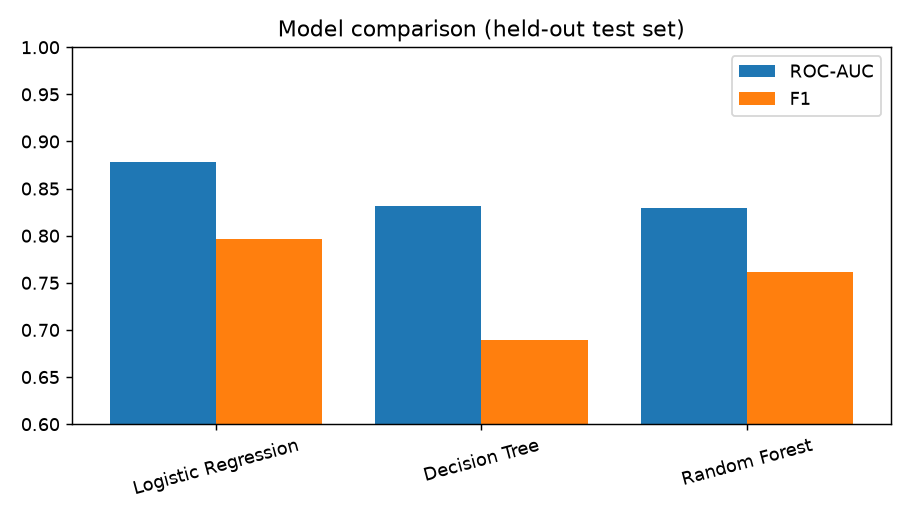
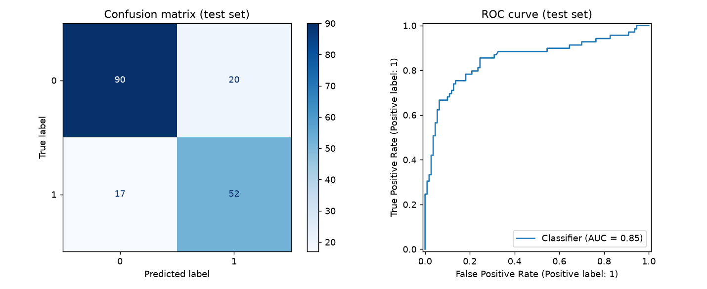

# Titanic Survival Prediction

Binary classification project that predicts whether a Titanic passenger survived. It covers the full workflow: EDA, feature engineering, model comparison, hyperparameter tuning, class-imbalance handling with SMOTE, and saving a reusable pipeline.

**Tech:** Python, pandas, NumPy, scikit-learn, imbalanced-learn (SMOTE), matplotlib, joblib

## Results

Evaluated on a stratified 80/20 split (179 held-out passengers). Model selection used 5-fold cross-validation on the training split only.

| Model | CV ROC-AUC | Test accuracy | Precision | Recall | F1 | Test ROC-AUC |
|---|---|---|---|---|---|---|
| Logistic Regression | 0.866 | 0.849 | 0.828 | 0.768 | 0.797 | 0.878 |
| Decision Tree (depth 5) | 0.836 | 0.793 | 0.820 | 0.594 | 0.689 | 0.832 |
| Random Forest (200 trees) | 0.867 | 0.821 | 0.785 | 0.739 | 0.761 | 0.829 |
| **Random Forest, tuned + SMOTE** | **0.878** | 0.793 | 0.722 | 0.754 | 0.738 | 0.852 |

Notes on reading these numbers:

- Random Forest had the best cross-validated ROC-AUC, so it was the model I tuned. Tuning lifted its test ROC-AUC from 0.829 to 0.852 and nudged recall up, but accuracy and precision dropped slightly.
- With only 179 test rows, differences of a few points are within noise. Plain Logistic Regression scores best on this particular test split, which is a useful reminder to compare against simple baselines.
- Only about 38% of passengers survived, so SMOTE was used on the training folds. It is applied inside the cross-validation pipeline, so synthetic samples never leak into validation data.

Key EDA findings: women survived at 74% vs 19% for men; survival fell with class (63% / 47% / 24% for 1st / 2nd / 3rd); Age is missing for about 20% of rows and Cabin for 77%.




## Approach

1. **EDA:** survival rate, missing values, survival by sex and class.
2. **Features:** `Title` (extracted from name, rare titles grouped), `FamilySize`, `IsAlone`. No feature uses the target.
3. **Preprocessing:** median imputation + scaling for numeric columns, mode imputation + one-hot encoding for categorical columns, all inside a `ColumnTransformer` so it is fit on training data only.
4. **Model comparison:** Logistic Regression, Decision Tree, Random Forest, scored with precision, recall, F1 and ROC-AUC.
5. **Tuning:** `GridSearchCV` over the best model with `SMOTE` inside an `imblearn` pipeline.
6. **Persistence:** the final pipeline (preprocessing + SMOTE + model) is saved with `joblib`.

## Project structure

```
├── data/titanic.csv            # public Titanic dataset (891 passengers)
├── src/train.py                # EDA, comparison, tuning, saving
├── src/predict.py              # load the saved pipeline and predict
├── models/titanic_pipeline.joblib
├── reports/                    # metrics.json and plots
└── requirements.txt
```

## Run it

```bash
pip install -r requirements.txt
python src/train.py      # trains, tunes, writes models/ and reports/
python src/predict.py    # example predictions from the saved pipeline
```

## What I would do next

- Repeated cross-validation or a larger validation scheme to reduce noise from the small test set.
- Compare SMOTE against `class_weight="balanced"` and threshold tuning.
- Try gradient boosting (XGBoost / LightGBM) and calibrate predicted probabilities.
